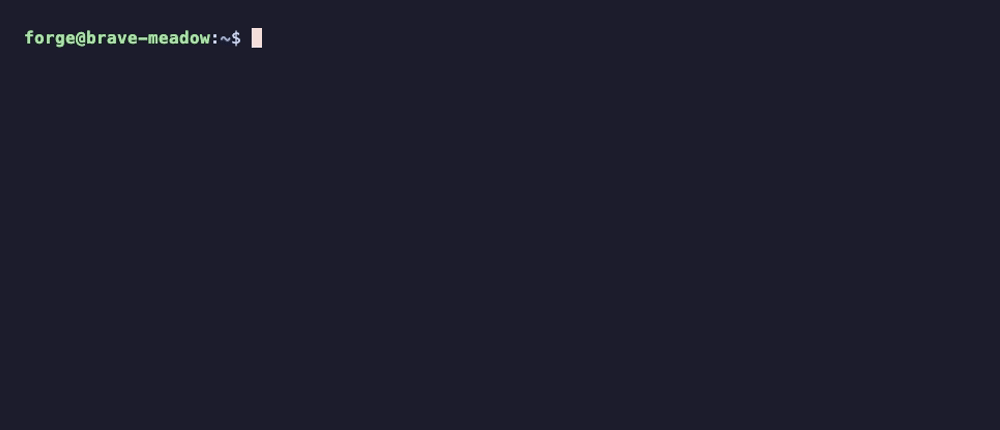

# Popcorn 🍿

Take your Laravel Forge (or other Nginx + PHP) sites offline and wait for the dust to settle.

Popcorn serves a static **503 maintenance page** through Caddy while Nginx is stopped, so you can patch PHP without visitors hitting a half-upgraded app. It reuses the certificates your Nginx config already points to, so HTTPS keeps working.

It's a single ~300-line bash script. Please read it before you run it.



## Install

```bash
sudo curl -fsSL https://github.com/Indemnity83/popcorn/releases/latest/download/popcorn.sh -o /usr/local/bin/popcorn && sudo chmod +x /usr/local/bin/popcorn
```

Run the same command again to update. To review before running anything, read it with `less /usr/local/bin/popcorn`. To pin a version, replace `latest/download` with `download/v2.0.0`. With wget, use `sudo wget -qO /usr/local/bin/popcorn URL`.

## Quick start

Paste this into your Forge server over SSH. It installs Popcorn, installs Caddy if it's missing, stops Nginx and starts Popcorn. If Popcorn can't start, it starts Nginx again.

```bash
sudo curl -fsSL https://github.com/Indemnity83/popcorn/releases/latest/download/popcorn.sh -o /usr/local/bin/popcorn && sudo chmod +x /usr/local/bin/popcorn && sudo popcorn install && sudo systemctl stop nginx && { sudo popcorn start || sudo systemctl is-active -q popcorn || sudo systemctl start nginx; }
```

When PHP is patched, bring the sites back. This checks the Nginx config before stopping Popcorn:

```bash
sudo nginx -t && sudo popcorn stop && sudo systemctl start nginx
```

**From the Forge dashboard:** commands run there as `forge`, and `sudo` needs a password. Run the same two lines without `sudo` in a Forge Recipe that runs as `root`.

## Step by step

```bash
sudo popcorn check       # lists the sites it found and what's left to do; changes nothing
sudo popcorn install     # only if check says Caddy is missing
sudo systemctl stop nginx
sudo popcorn start       # serves the page, then checks every hostname answers 503
```

Also check from another machine. You should get **503** with `Retry-After: 600` and `Cache-Control: no-store`:

```bash
curl -sI https://example.com/
```

When PHP is patched (and any PHP-FPM services you stopped are running again):

```bash
sudo nginx -t                    # make sure Nginx will start before taking the page down
sudo popcorn stop                # stops Caddy and deletes everything Popcorn generated
sudo systemctl start nginx
```

`sudo popcorn status` repeats the hostname checks at any time. Logs: `sudo journalctl -u popcorn -n 50 --no-pager`

## Where it works

Built for Laravel Forge, and also tested on Ubuntu 24.04 and Debian 12 servers running Nginx and PHP-FPM with Certbot certificates. In general it needs root, systemd, Nginx installed on the host, and certificate files on disk.

It's **not** for Apache, cPanel or Plesk (their service monitors may restart the web server), Nginx running in Docker, or shared hosting.

## How it works

- `nginx -T` prints the full Nginx config with every include resolved, and works with Nginx stopped. Popcorn collects each `ssl_certificate` / `ssl_certificate_key` pair from it.
- Each certificate must be unexpired and match its key. HTTPS hostnames come from the certificate itself, so every name served over HTTPS is covered by its certificate. An unusable certificate is skipped (and listed by `check`); those hostnames get the HTTP page only.
- Port 80 answers every hostname.
- The Caddy config and certificate copies live in `/run/popcorn`, which is cleared on reboot. Caddy runs as the `caddy` user in a transient `popcorn.service` that is never enabled at boot, so a reboot brings your normal Nginx setup back.
- Popcorn never edits Nginx config, and never starts or stops Nginx, PHP-FPM or queue workers.

## Worth knowing

- **Certificate renewals aren't picked up while Popcorn runs.** Run `stop` then `start`.
- **Wildcard certificates** are served as wildcards, but `start` and `status` can only check concrete hostnames. A hostname no certificate covers fails the TLS handshake.
- **Installing Caddy** uses your configured apt repos. If your Ubuntu release doesn't package it, add [Caddy's repo](https://caddyserver.com/docs/install#debian-ubuntu-raspbian) first. The stock `caddy.service` is kept from starting and left disabled.

## Upgrading

Run the install command again. That's safe while Popcorn is running: the new version takes effect when you `stop` and then `start`. `popcorn version` prints the installed version, and `status` shows the version that's actually running.

**From v1** (the original ~1,100-line `popcorn.sh`; `version` gives an error): install as above and run `sudo popcorn start`, even while v1 is serving. Once the new config validates, Popcorn removes v1 as its `teardown` did (its unit and `/etc/popcorn`, including key copies and backups) and starts. Sites are unreachable for a second or two. Nothing is deleted unless v1's ownership markers are present.

Found a Forge setup it doesn't handle? [Open an issue](https://github.com/Indemnity83/popcorn/issues).
